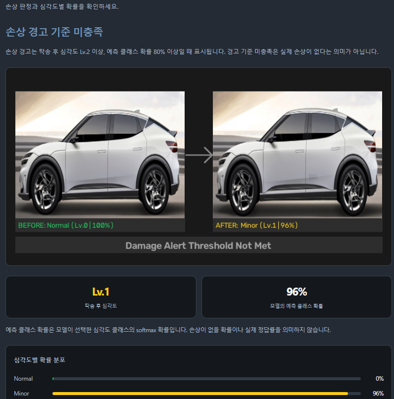
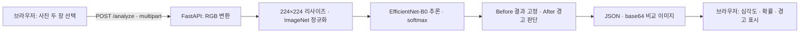

# 🚗 CarGuard

**차량 사진의 손상 심각도를 Lv.0~Lv.4로 분류하는 AI 웹 데모**입니다. 탁송 차량의 상태 점검을 보조하는 것을 목표로, EfficientNet-B0 모델을 FastAPI와 연결하고 사진 업로드부터 결과 시각화까지 구성했습니다.

**[현재 Render 데모](https://vehicle-damage-detection-sm5j.onrender.com)** · Python · PyTorch · FastAPI · OpenCV · HTML/CSS/JavaScript

> **현재 분석 범위:** 비교 로직은 탁송 전(Before) 심각도를 Lv.0으로 고정하고 탁송 후(After) 사진을 분류합니다. 기존 손상을 제외한 신규 손상이나 손상 발생 시점을 판별하지 않습니다.

## 현재 서비스 화면

| 사진 선택·미리보기 | 분석 결과 |
|---|---|
|  |  |

## 주요 기능

- 전·후 사진 선택, 드래그앤드롭, 업로드 전 미리보기
- After 사진의 5단계 손상 심각도와 클래스별 예측 확률 표시
- Lv.2 이상이면서 예측 클래스 확률이 80% 이상일 때 손상 경고 표시
- 전·후 사진을 나란히 배치한 비교 이미지 생성
- 로딩·오류 안내, 재분석 및 PC·모바일 반응형 화면

## 프로젝트 배경과 개인 고도화 범위

출발점은 기사 매칭·리뷰 감정 분석·차량 흠집 탐지를 다룬 [4인 팀 프로젝트](https://github.com/rkdwltn1211/vehicle-delivery-ai-system)입니다. 팀 프로젝트에서 차량 흠집 탐지 파트를 담당했고, 이후 해당 파트를 별도 프로젝트로 고도화했습니다. 다른 팀원의 매칭·리뷰·DB 구현은 개인 기여에 포함하지 않습니다.

| 구분 | 초기 팀 프로젝트의 흠집 탐지 | 개인 고도화 프로젝트 |
|---|---|---|
| 모델 접근 | 전·후 RGB와 차이를 결합한 9채널 ResNet18 회귀 | 3채널 RGB 기반 EfficientNet-B0의 5클래스 분류 |
| 데이터 처리 | OpenCV 변화 후보 시각화, 차량별 다방향 입력 | 변화 후보를 학습 패치로 생성하고 증강 적용 |
| 학습 관리 | 회귀 손실 기반 학습 | 클래스 가중 손실, 검증, 최고 모델 저장, 조기 종료 |
| 서비스 구성 | JSON·Excel 연동 및 폴더 감시 코드 | FastAPI API, 웹 UI, 결과 시각화, CPU 환경 배포 |

개인 버전은 학습·서비스 구조를 재구성한 결과이며, 초기 모델보다 정확도가 높아졌다는 비교 실험 결과는 확보하지 못했습니다. 실제 Before 정보를 모델 입력으로 활용하던 초기 방식과 달리, 현재 웹 비교는 Before를 정상으로 가정합니다.

## 서비스 구조와 기술적 선택

### 웹 서비스 추론 — main.py, index.html



- `load_model()`은 모듈 로딩 시 `model/best_model.pth`를 읽고 요청 간 재사용합니다. 추론은 `eval()`과 `torch.no_grad()`를 사용합니다.
- `analyze()`는 두 사진을 모두 추론하지만 Before 예측을 `severity=0`, `confidence=1.0`으로 덮어씁니다. After 결과만 최종 경고에 반영합니다.
- `make_result_image()`의 OpenCV 처리는 사진·문구 합성입니다. 웹 요청에는 ECC 정렬, ROI 추출, 손상 위치 박스가 연결되어 있지 않습니다.
- 웹 API는 `step1~3`를 호출하거나 요청 중 모델을 학습하지 않습니다.

### 데이터 준비와 모델 학습 — 별도 오프라인 과정

```text
전·후 원본 사진 + 차량별 labels.csv
  → step1: 회색조·CLAHE → ECC 평행이동 정렬 → 차이 마스크
           → 모폴로지·윤곽선 필터 → After ROI 크롭
           → 패치 단위 train/val 분리 → train 증강 저장
  → step2: EfficientNet-B0 학습·검증
  → model/best_model.pth, model/training_log.png
```

`step1_prepare_data.py`는 후보 박스가 없으면 After 전체 사진을 사용하고, 차량 라벨을 해당 차량의 패치에 부여합니다. 현재 코드에는 Canny 호출이 없습니다.

`step2_train_cnn.py`는 ImageNet 사전학습 가중치를 사용하고 분류기를 교체한 뒤 **전체 모델을 미세조정(Fine-tuning)**합니다. 클래스 가중 CrossEntropyLoss, AdamW, CosineAnnealingLR를 사용하며 검증 정확도 기준으로 최고 모델을 저장합니다. 최대 30 epoch, batch size 16, Early Stopping patience 5로 설정되어 있습니다.

`step3_pipeline.py`는 웹과 별개의 로컬 추론 도구입니다. After 전체 사진을 분류하고, 여러 방향의 예측 중 최대 심각도로 차량 결과를 요약합니다. 학습용 ROI 추출을 추론에 적용하지 않습니다.

### 기술별 역할과 선택 의도

| 기술 | 역할과 설계상 이점 |
|---|---|
| PyTorch / EfficientNet-B0 | 사전학습 특징을 재사용해 5단계 분류 모델을 구성하고 CPU 추론으로 서비스 연결 |
| FastAPI / Uvicorn | 파일 업로드·JSON API와 HTML을 같은 서버에서 제공 |
| OpenCV / Pillow | 학습 후보 영역 처리, 업로드 이미지 디코딩, 결과 이미지 합성 |
| HTML/CSS/JavaScript | 별도 프론트엔드 빌드 없이 미리보기·비동기 요청·반응형 결과 화면 구성 |
| CPU 전용 PyTorch | GPU 없이 실행되는 환경을 구성해 Render Free Web Service에 배포 |

## 배포 환경과 확인 결과

| 항목 | 현재 환경 |
|---|---|
| 서비스 | [Render 데모](https://vehicle-damage-detection-sm5j.onrender.com) |
| 플랫폼 | Render Free Web Service |
| 배포 브랜치 | `ui-redesign` |
| Python | 3.12.14 |
| 추론 | CPU 전용 PyTorch |

다음은 개발자가 배포 환경에서 확인한 **수동 기능 검증 결과**입니다.

| 검증 항목 | 결과 |
|---|---|
| 실제 차량 사진 분석 | 성공 |
| 동일 이미지 3회 반복 분석 | 성공 |
| PC·모바일 UI | 동작 확인 |
| 일정 시간 미사용 후 재접속 | 성공 |

위 결과는 모델 정확도 평가나 동시 요청 부하 테스트를 의미하지 않습니다. 배포 검증일과 실제 Build/Start Command는 추가 기록이 필요합니다. 무료 환경의 정책·사용 한도는 변경될 수 있으며 이 문서에서 보장하지 않습니다.

**과거 AWS 배포:** 과거 Git 문서에는 EC2 t3.micro, Ubuntu 22.04, systemd와 공개 데모 주소가 기록되어 있습니다. 현재 공개 데모는 Render입니다. 당시 서비스 설정·운영 로그는 저장소에서 확인되지 않아 세부 운영 구성을 재현한 것으로 주장하지 않습니다.

## 로컬 실행과 API

### 웹 추론 실행

배포에 사용한 Python은 3.12.14입니다. 아래 명령은 현재 파일·API 구조에 맞춘 실행 절차이며, 별도의 깨끗한 로컬 환경에서 설치 재현 검증은 필요합니다.

```bash
git clone --branch ui-redesign https://github.com/rkdwltn1211/vehicle-damage-detection.git
cd vehicle-damage-detection
python -m venv .venv
```

가상환경 활성화:

```bash
# macOS / Linux
source .venv/bin/activate
```

```powershell
# Windows PowerShell
.\.venv\Scripts\Activate.ps1
```

```bash
python -m pip install -r requirements.txt
python -m uvicorn main:app --host 0.0.0.0 --port 8000
```

브라우저에서 `http://localhost:8000`에 접속합니다. `index.html`을 읽는 경로가 작업 폴더 기준이므로 **프로젝트 루트에서 실행**해야 합니다. `model/best_model.pth`도 필요하며, 모델 로딩 실패 시 서버가 시작되지 않습니다.

학습 재현은 별도 준비가 필요합니다. 원본 데이터·생성 dataset은 현재 작업 트리에 없고, `step1~3`에는 개인 PC 절대경로가 남아 있습니다. `requirements.txt`는 웹 추론용이며 학습 코드의 pandas·scikit-learn·Matplotlib을 포함하지 않습니다.

### API

| Method | Endpoint | 입력 / 응답 |
|---|---|---|
| GET | `/` | 웹 UI 반환 |
| GET | `/health` | `status`, `device` 반환 |
| POST | `/analyze` | 필수 multipart 파일 `before`, `after` → 분석 JSON |

`/analyze`의 주요 응답:

| 필드 | 의미 |
|---|---|
| `before` | 정상으로 고정한 심각도·라벨·색상·확률. 모델 판정값이 아님 |
| `after` | `severity`, `label`, `color`, `desc`, `confidence`, 5클래스 `probs` |
| `damage_detected` | After Lv.2 이상·확률 80% 이상·양의 변화량 조건의 경고 여부 |
| `severity_change` | After 심각도 − 고정된 Before 심각도. 실제 전후 변화량이 아님 |
| `result_image` | JPEG 비교 이미지의 base64 문자열 |

`confidence`는 선택 클래스의 **softmax 확률**이며 실제 정답률이나 신규 손상 발생 확률이 아닙니다. 경고 기준 미충족도 무손상을 보장하지 않습니다. 파일의 MIME이 `image/`로 시작하지 않으면 400을 반환하며, 이미지 디코딩 실패 등에 대한 별도 예외 처리는 아직 없습니다.

## 한계와 개선 계획

| 현재 한계 | 다음 검증·개선 방향 |
|---|---|
| Before를 정상으로 고정 | 실제 전후 특징·위치 비교로 기존 손상과 신규 손상 구분 |
| 웹에 손상 위치 표시 없음 | 변화 후보 또는 위치 설명을 추론 경로에 연결하고 검증 |
| 패치 단위 분할과 과거 train/val 동일 이미지 중복 | 차량 단위 분리·중복 제거 후 독립 테스트셋 평가 |
| 학습 패치와 추론 전체 사진의 입력 차이 | 동일 입력 조건으로 학습·추론 비교 |
| 저장 그래프·문서·데이터 집계의 연결 근거 부족 | 실행별 데이터·설정·체크포인트·평가 리포트 함께 기록 |
| 업로드 제한·예외 처리·동시 요청 검증 부족 | 크기·디코딩 검증과 오류 응답 보완, 자원·지연시간 측정 |

기존 문서의 검증 정확도·증강 수량은 저장 자료와 불일치해 대표 성과에서 제외했습니다. 현재 학습 그래프와 체크포인트의 실행 조건도 재확인이 필요합니다. 새 이미지에 대한 일반화 성능 개선은 아직 입증하지 않았습니다.

## 주요 파일과 상세 기록

```text
main.py                    # 웹 API·모델 로딩·추론·결과 이미지
index.html                 # CSS·JavaScript를 포함한 웹 UI
requirements.txt           # CPU 웹 추론 의존성
step1_prepare_data.py       # OpenCV 학습 데이터 생성
step2_train_cnn.py          # EfficientNet-B0 학습·검증
step3_pipeline.py           # 로컬 다방향 추론·비교 이미지 저장
labels.csv                 # 차량별 심각도 라벨
model/best_model.pth        # 서비스가 로드하는 체크포인트
model/training_log.png      # 저장된 학습 곡선
docs/screenshots/          # 현재 서비스의 사진 선택·분석 결과 화면
```

상세 실험 이력·데이터 검증·배포 문제 해결 과정은 별도 기술 기록(Notion)으로 분리할 예정입니다. 공개 문서 링크는 준비 후 추가합니다.

- [초기 팀 프로젝트](https://github.com/rkdwltn1211/vehicle-delivery-ai-system)
- [개발자 GitHub](https://github.com/rkdwltn1211)
- 문의: GitHub Issues
