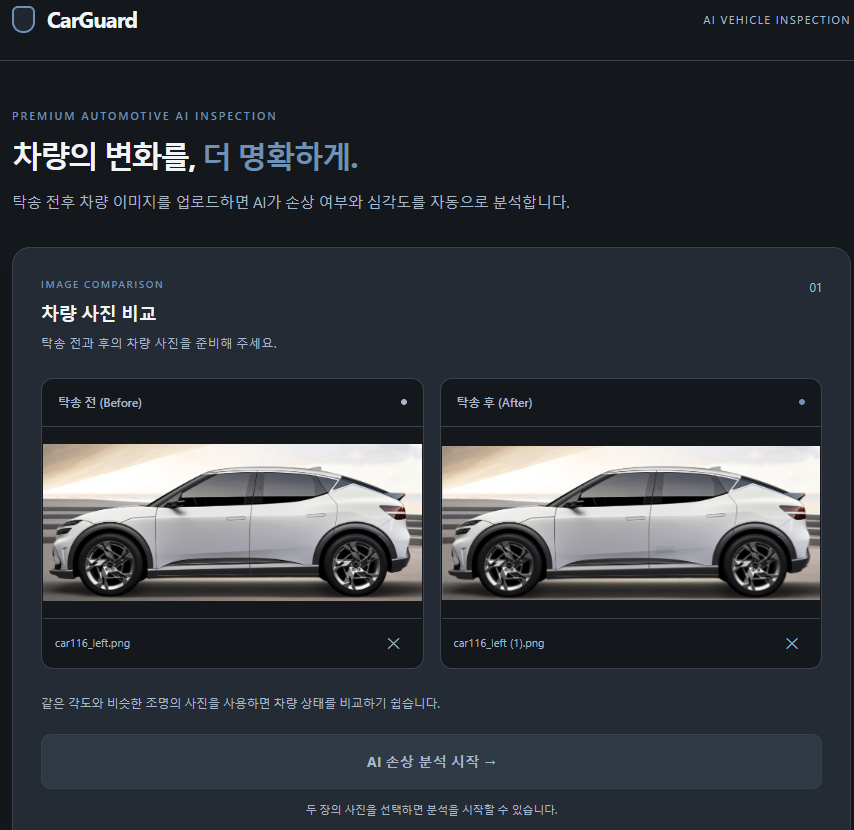
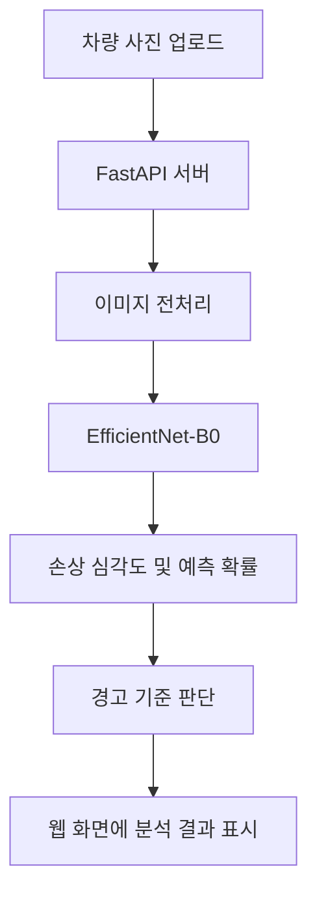
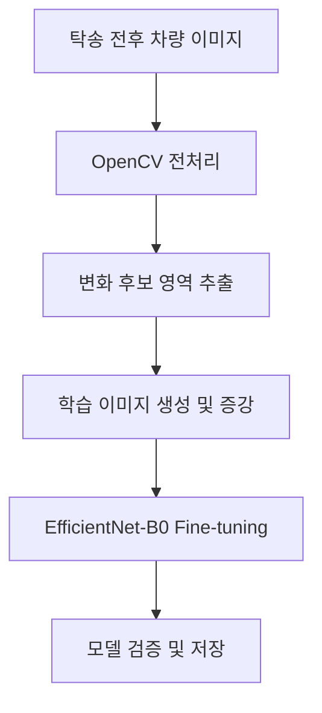

# 🚗 CarGuard

### AI 기반 차량 손상 심각도 분석 웹 서비스

CarGuard는 차량 사진을 분석해 손상 심각도를 **Lv.0~Lv.4의 5단계로 분류하는 웹 서비스**입니다.

차량 탁송 과정에서는 기존에 있던 흠집과 새로 발생한 흠집을 구분하는 것이 중요합니다. 이러한 문제에서 출발해 차량 손상 분석 모델을 개발하고, 사용자가 직접 사진을 업로드해 분석 결과를 확인할 수 있도록 웹 서비스로 구현했습니다.

**[🚀 CarGuard 서비스 체험하기](https://vehicle-damage-detection-sm5j.onrender.com)**

`Python` `PyTorch` `EfficientNet-B0` `FastAPI` `OpenCV` `JavaScript` `Render`

> 현재 버전은 탁송 후 사진의 손상 심각도를 분류하는 데 초점을 맞추고 있습니다. 기존 손상과 신규 손상을 구분하는 전후 이미지 비교 기능은 향후 개선할 계획입니다.
>
> Render 무료 서버를 사용하므로 일정 시간 접속이 없으면 서버가 중지될 수 있으며, 첫 접속 시 로딩 시간이 발생할 수 있습니다.

---

## 1. 서비스 화면

| 차량 사진 업로드 | AI 분석 결과 |
|---|---|
|  |  |

### 주요 기능

- **차량 사진 업로드:** 탁송 전후 사진 선택, 드래그 앤 드롭, 이미지 미리보기
- **AI 손상 분석:** EfficientNet-B0를 이용한 5단계 손상 심각도 분류
- **분석 결과 시각화:** 예측 심각도, 클래스별 예측 확률, 손상 경고 표시
- **이미지 비교 화면:** 탁송 전후 사진을 나란히 보여주는 결과 이미지 생성
- **반응형 웹 UI:** PC와 모바일에서 사용할 수 있는 화면 구성

손상 경고는 탁송 후 사진의 예측 심각도가 **Lv.2 이상**이고, 해당 클래스의 예측 확률이 **80% 이상**일 때 표시됩니다.

여기서 예측 확률은 모델이 선택한 클래스의 softmax 출력값이며, 실제 손상 발생 확률이나 모델의 정확도를 의미하지는 않습니다.

---

## 2. 프로젝트 배경

CarGuard는 차량 탁송 서비스를 주제로 진행했던 [4인 팀 프로젝트](https://github.com/rkdwltn1211/vehicle-delivery-ai-system)에서 시작했습니다.

당시 기사 매칭, 리뷰 감정 분석, 차량 흠집 탐지 기능을 개발했으며, 저는 **차량 흠집 탐지 파트**를 담당했습니다.

팀 프로젝트가 끝난 뒤에도 차량 이미지 분석 기능을 더 발전시키고 싶었습니다. 기존 모델을 다시 검토하면서 학습 방식과 모델 구조를 변경했고, 분석 결과를 직접 확인할 수 있는 웹 서비스까지 구현했습니다.

### 팀 프로젝트에서 개인 프로젝트로

| 구분 | 기존 팀 프로젝트 | CarGuard 개인 고도화 |
|---|---|---|
| 모델 | 9채널 ResNet18 기반 회귀 | EfficientNet-B0 기반 5클래스 분류 |
| 데이터 처리 | 전후 이미지 차이 분석 및 시각화 | OpenCV 기반 변화 후보 추출 및 학습 데이터 생성 |
| 학습 방식 | 회귀 손실 기반 학습 | 클래스 가중 손실, Fine-tuning, Early Stopping |
| 서비스 | JSON·Excel 연동 및 폴더 감시 코드 | FastAPI 웹 API, 분석 결과 UI, Render 배포 |

이번 개인 프로젝트에서는 **모델 학습 구조를 변경하고, 사용자가 직접 이용할 수 있는 웹 서비스를 만드는 것**에 집중했습니다.

---

## 3. 시스템 구조

CarGuard는 모델 학습 과정과 웹 서비스의 추론 과정을 분리해 구성했습니다.

### 웹 서비스



사용자가 차량 사진을 업로드하면 FastAPI 서버에서 이미지를 처리한 뒤 PyTorch 모델로 추론합니다.

입력 이미지는 224×224 크기로 조정하고 ImageNet 기준으로 정규화합니다. 모델은 5개 클래스의 예측 확률을 계산하며, 가장 높은 확률을 가진 클래스를 최종 심각도로 선택합니다.

분석 결과는 JSON으로 반환하고, 프론트엔드에서 심각도와 예측 확률을 시각화합니다. 탁송 전후 사진을 나란히 배치한 비교 이미지도 함께 제공합니다.

현재 웹 서비스에서는 두 사진을 모델에 입력하지만, 최종 비교 계산에서 탁송 전 심각도를 Lv.0으로 고정합니다. 따라서 경고 여부는 실질적으로 탁송 후 사진의 분류 결과를 기준으로 결정됩니다.

### 모델 학습



학습 데이터를 준비할 때는 OpenCV를 이용해 전후 이미지의 차이가 나타나는 영역을 추출했습니다.

CLAHE로 이미지 대비를 보정하고, ECC 정렬과 차이 마스크를 이용해 변화 후보 영역을 찾았습니다. 이후 모폴로지 연산과 윤곽선 필터링으로 후보 영역을 정리하고, 해당 영역을 학습 이미지로 사용했습니다.

변화 후보가 검출되지 않은 경우에는 탁송 후 전체 이미지를 사용하도록 구성했습니다.

이 과정은 **모델 학습용 데이터를 만드는 별도의 오프라인 작업**이며, 현재 웹 서비스에서 실시간으로 실행되는 과정은 아닙니다.

---

## 4. AI 모델 학습

### EfficientNet-B0 선택

기존 팀 프로젝트에서는 ResNet18 기반 회귀 모델을 사용했습니다.

개인 프로젝트에서는 손상 정도를 0~4의 단계로 구분하는 문제에 맞춰 **EfficientNet-B0 기반 다중 클래스 분류 모델**로 변경했습니다.

ImageNet 사전학습 가중치를 활용하고, 마지막 분류기를 5개 클래스에 맞게 교체한 뒤 전체 모델을 Fine-tuning했습니다.

### 학습 설정

| 항목 | 설정 |
|---|---|
| 모델 | EfficientNet-B0 |
| 출력 | 5개 클래스 (Lv.0~Lv.4) |
| Loss | Class-weighted CrossEntropyLoss |
| Optimizer | AdamW |
| Scheduler | CosineAnnealingLR |
| Batch Size | 16 |
| 최대 Epoch | 30 |
| Early Stopping | Patience 5 |
| 모델 저장 | 검증 정확도 기준 최고 모델 |

손상 등급별 데이터 수의 차이를 고려해 클래스 가중 손실 함수를 사용했습니다.

또한 검증 정확도를 기준으로 가장 성능이 좋은 모델을 저장하고, 일정 기간 개선이 없으면 학습을 종료하도록 Early Stopping을 적용했습니다.

현재 모델의 성능 수치는 데이터 분할 및 평가 기록을 재검토한 뒤 추가할 계획입니다.

---

## 5. 기술 스택

| 구분 | 기술 | 사용 목적 |
|---|---|---|
| AI / Deep Learning | Python, PyTorch, EfficientNet-B0 | 차량 손상 심각도 분류 모델 학습 및 추론 |
| Image Processing | OpenCV, Pillow | 이미지 전처리, 변화 후보 추출, 결과 이미지 생성 |
| Backend | FastAPI, Uvicorn | 이미지 업로드 및 AI 추론 API |
| Frontend | HTML, CSS, JavaScript | 업로드 화면, 비동기 분석 요청, 결과 시각화 |
| Deployment | Render | CPU 기반 웹 서비스 배포 |
| Version Control | Git, GitHub | 코드 및 배포 버전 관리 |

---

## 6. Render 무료 배포

기존에는 AWS EC2 환경에서 서비스를 배포했지만, 프로젝트를 지속적으로 공개하고 관리하기 위해 **Render 무료 Web Service로 재배포**했습니다.

GPU가 없는 환경에서도 모델을 실행할 수 있도록 CPU 전용 PyTorch를 사용했고, FastAPI 서버는 Uvicorn Worker 1개로 실행하도록 구성했습니다.

### 배포 환경

| 항목 | 설정 |
|---|---|
| Platform | Render Free Web Service |
| Region | Singapore |
| Python | 3.12.14 |
| AI Runtime | PyTorch CPU |
| Web Server | Uvicorn |
| Workers | 1 |
| Deploy Branch | `ui-redesign` |

**Build Command**

```bash
python -m pip install --only-binary=:all: -r requirements.txt
```

**Start Command**

```bash
uvicorn main:app --host 0.0.0.0 --port $PORT --workers 1
```

### 배포 후 테스트

배포 완료 후 실제 차량 사진을 업로드해 기능을 확인했습니다.

| 테스트 항목 | 결과 |
|---|---|
| FastAPI 서버 및 모델 로딩 | 정상 |
| 차량 사진 업로드 및 AI 분석 | 정상 |
| 동일 이미지 3회 반복 분석 | 정상 |
| PC 웹 화면 | 정상 |
| 모바일 반응형 화면 | 정상 |
| 일정 시간 미사용 후 재접속 | 정상 |

무료 환경에서도 모델 로딩과 실제 추론 요청이 정상적으로 처리되는 것을 확인했습니다.

다만 CPU·RAM 사용량을 직접 측정하거나 동시 접속 부하 테스트를 진행한 것은 아니므로, 서버의 장시간 안정성과 동시 처리 성능은 추가 검증이 필요합니다.

---

## 7. 로컬 실행 방법

Python 3.12.14 환경을 기준으로 작성했습니다.

### 저장소 복제

```bash
git clone --branch ui-redesign https://github.com/rkdwltn1211/vehicle-damage-detection.git
cd vehicle-damage-detection
```

### 가상환경 생성 및 활성화

```bash
python -m venv .venv
```

Windows PowerShell:

```powershell
.\.venv\Scripts\Activate.ps1
```

macOS / Linux:

```bash
source .venv/bin/activate
```

### 패키지 설치 및 서버 실행

```bash
python -m pip install -r requirements.txt
python -m uvicorn main:app --host 0.0.0.0 --port 8000
```

서버 실행 후 브라우저에서 `http://localhost:8000`에 접속하면 됩니다.

`model/best_model.pth` 파일이 필요하며, 프로젝트 루트 디렉터리에서 실행해야 합니다.

> 현재 `requirements.txt`는 웹 서비스 추론용입니다. 학습 코드를 재실행하려면 추가 라이브러리와 원본 데이터 경로 설정이 필요합니다.

---

## 8. API

| Method | Endpoint | 설명 |
|---|---|---|
| GET | `/` | 웹 UI 반환 |
| GET | `/health` | 서버 상태 및 실행 디바이스 확인 |
| POST | `/analyze` | 탁송 전후 사진 업로드 및 분석 |

`POST /analyze`는 `multipart/form-data` 형식으로 `before`, `after` 이미지 파일을 받습니다.

주요 응답 데이터는 다음과 같습니다.

| 필드 | 설명 |
|---|---|
| `before` | 탁송 전 심각도 정보 (현재 Lv.0 고정) |
| `after` | 탁송 후 예측 심각도 및 클래스별 확률 |
| `damage_detected` | 설정된 손상 경고 기준 충족 여부 |
| `severity_change` | 고정된 Before 기준의 심각도 차이 |
| `result_image` | Base64 인코딩된 비교 이미지 |

---

## 9. 한계 및 향후 개선 방향

CarGuard의 최종 목표는 **탁송 전후 차량 상태를 비교해 새로 발생한 손상을 확인하는 것**입니다.

현재는 차량 사진의 손상 심각도를 분류하는 모델을 웹 서비스로 구현한 단계이며, 다음 부분을 개선할 계획입니다.

**1. 실제 전후 이미지 비교**

현재는 Before 심각도를 Lv.0으로 고정하고 있어 기존 손상과 신규 손상을 구분하지 못합니다.

향후 이미지 간 변화와 손상 위치를 함께 분석하는 방식으로 개선할 계획입니다.

**2. 모델 성능 재평가**

기존 학습 데이터에서 train/validation 이미지 중복 가능성과 데이터 분할 방식의 한계를 확인했습니다.

차량 단위로 데이터를 분리하고 독립적인 테스트셋을 구성해 모델 성능을 다시 평가할 계획입니다.

**3. 학습·추론 입력 방식 개선**

학습 과정에서는 변화 후보 영역을 잘라낸 패치를 사용하지만, 웹 서비스에서는 전체 이미지를 입력합니다.

이러한 입력 차이가 예측에 미치는 영향을 확인하고 학습과 추론 조건을 개선할 계획입니다.

**4. 서비스 안정성 개선**

이미지 파일 크기 제한, 예외 처리, 서버 응답 시간 측정 및 동시 요청 테스트 등을 추가할 계획입니다.

---

## 10. 프로젝트 구조

```text
vehicle-damage-detection/
├── main.py                  # FastAPI 서버 및 AI 추론
├── index.html               # 웹 UI
├── requirements.txt         # 배포 의존성
├── step1_prepare_data.py    # 학습 데이터 전처리
├── step2_train_cnn.py       # EfficientNet-B0 학습
├── step3_pipeline.py        # 로컬 추론 파이프라인
├── labels.csv               # 차량별 심각도 라벨
├── model/
│   ├── best_model.pth       # 학습된 모델
│   └── training_log.png     # 학습 기록
└── docs/
    └── screenshots/
        ├── sc1.png          # 사진 업로드 화면
        └── sc2.png          # 분석 결과 화면
```

---

## 관련 링크

- [CarGuard Live Demo](https://vehicle-damage-detection-sm5j.onrender.com)
- [초기 팀 프로젝트 GitHub](https://github.com/rkdwltn1211/vehicle-delivery-ai-system)
- [개발자 GitHub](https://github.com/rkdwltn1211)

문의 및 피드백은 GitHub Issues를 이용해 주세요.
